# 🎮 FableGames · 潮玩网页微游戏聚合站

> 参考 **CrazyGames.com** 现代暗黑霓虹视觉与交互风格打造的高性能网页小游戏聚合门户，支持即点即玩、多语言（中英文）切换、独立游戏竞技场、本地持久化收藏与极简扩展。

🔗 **GitHub 仓库**：[https://github.com/xinayida/fablegames](https://github.com/xinayida/fablegames)

---

## ⚡ 本地极速启动 (Quick Start)

由于现代浏览器（Chrome、Edge、Safari）对本地 `file://` 协议存在严格的跨域与存储限制（可能会阻断 iframe 内游戏的音频、WebGL 资源及 LocalStorage），**推荐使用轻量级静态服务在本地启动**：

### 方式一：使用 Node.js / npx（推荐 🌟）

无需额外配置或全局安装，在项目根目录直接运行：

```bash
# 免安装直接启动轻量级静态服务器
npx serve -l 8080 .

# 或通过 package.json 脚本启动
npm start
# 或
npm run dev
```

> 打开浏览器访问 👉 **[http://localhost:8080](http://localhost:8080)** 即可即刻畅玩！

---

### 方式二：使用 VS Code / Cursor 插件

如果你在编辑器中打开了本项目：
1. 安装 **Live Server** 插件。
2. 在 `index.html` 上右键，点击 **「Open with Live Server」** 即可。

---

### 方式三：使用任意本地静态服务器

你也可以使用任何你熟悉的静态服务器工具（例如 `http-server` 等）：

```bash
# 使用 http-server
npx http-server -p 8080 -c-1 .
```

---

## 🕹️ 精选游戏阵容与开源出处 (Featured Games & Credits)

本平台汇聚由 **Claude Fable 5.2** 端到端全自动生成的次世代网页微游戏（当前共收录 **60 款** 精品游戏），所有游戏均保留原作者署名、开源仓库与在线体验出处：

| 游戏画面 | 游戏名称 | 英文名称 | 分类 | 游玩方式 | 作者 / 开源出处 | 亮点说明 |
| :---: | :--- | :--- | :--- | :--- | :--- | :--- |
| 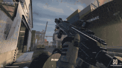 | **Saltline · 盐线 (3A第一人称射击)** | Saltline: 3A Web FPS | 动作射击 | 云端嵌入 | [realcodebear](https://github.com/realcodebear/saltline-fable-5.2) | 由 Claude Fable 5.2 全自动端到端编码生成的 3A 级写实光影码头第一人称射击游戏。 |
| 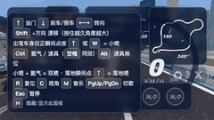 | **QQ飞车 3D · 极速漂移** | QQ Speed 3D: Drift Racing | 竞速漂移 | 本地离线 | [riba2534](https://github.com/riba2534/claude-opus-5-5-demo) | 由 Claude Fable 5.2 制作的高保真 3D 竞速大作！纯 WebGL 还原 QQ飞车经典地图（11城、爱琴海、金字塔），支持漂移集气与双喷！ |
| 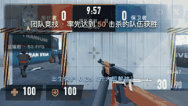 | **穿越火线 · 运输船 3D** | CrossFire: Transport Ship 3D | 动作射击 | 本地离线 | [@Claude Fable 5.2 Studio](https://github.com/riba2534/claude-opus-5-5-demo) · [体验](games/cf-transport-ship.html) | 由 Claude Fable 5.2 打造的经典穿越火线「运输船」3D 原生复刻：团队竞技对决，保卫者 vs 潜伏者！ |
| 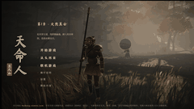 | **黑神话 · 悟空 (天命人)** | Black Myth: Wukong (Destined One) | 3A冒险 | 云端嵌入 | [oneoyn](https://github.com/oneoyn) | 由 Claude Fable 5.2 打造的三维西游动作 RPG，扮演天命人，重温六卷西行路。劈棍连击与神通法术！ |
| 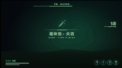 | **黑神话 · 关羽** | Black Myth: Guan Yu | 3A冒险 | 云端嵌入 | [fablegames](https://github.com/xinayida/fablegames) | Claude Fable 5.2 制作的三国武圣关羽写实动作独立微游戏，手握青龙偃月刀，施展破风刀气与龙魂斩击！ |
|  | **英雄联盟 · 海克斯大乱斗** | League of Legends: Hextech ARAM | 角色扮演 | 云端嵌入 | [@Claude Fable 5.2 Studio](https://github.com/hanyue) · [体验](https://lol.hanyue.io/) | Claude Fable 5.2 制作的嚎哭深渊极地大乱斗！自选英雄、神话装备搭配、抽取海克斯强化符文，极速推塔！ |
| 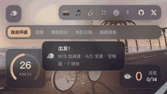 | **鹈鹕骑单车 · 沿海追鱼** | Pelican on a Bike: Coastline Cruise | 休闲治愈 | 本地离线 | [riba2534](https://github.com/riba2534/claude-opus-5-5-demo) | Claude Fable 5.2 打造的治愈系 3D 漫游作品！可爱白鹈鹕骑着复古单车在落日海岸线追逐鱼群！ |
| 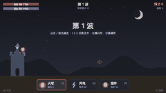 | **元素法师 · 火球与闪电** | Elemental Mage: Fire & Lightning | 动作射击 | 本地离线 | [fablegames](https://github.com/xinayida/fablegames) | Claude Fable 5.2 独立制作的元素法师！在战场中交织轰击连珠火球与连锁闪电，全屏割草解压！ |
|  | **豆包炫舞 · 3D节奏竞舞** | Doubao Dance: 3D Rhythm & Beat | 休闲治愈 | 本地离线 | [@Claude Fable 5.2 (riba2534)](https://github.com/riba2534/claude-opus-5-5-demo/tree/fable-5.2-doubao/doubao-dance) · [体验](games/doubao-dance.html) | Claude Fable 5.2 独立生成的 3D 劲舞节奏游戏！敲方向键踩重拍，和豆包一起登台PK！ |
| 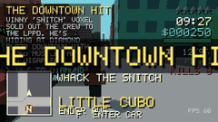 | **像素侠盗猎车手 · 城市漫游** | Fable Theft Auto: Voxel City | 动作射击 | 本地离线 | [sorrycc/fable-arcade](https://github.com/sorrycc/fable-arcade) | Claude Fable 单提示词生成的体素版 GTA！驾驶车辆漫游积木都市，接受任务单挑市中心线人！ |
| 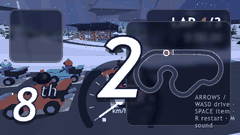 | **霜线卡丁车 · 极地冰雪竞速** | Frostline Kart: Snow Circuit | 竞速漂移 | 本地离线 | [sorrycc/fable-arcade](https://github.com/sorrycc/fable-arcade) | Claude Fable 独立构建的 3D 冰雪卡丁车！8 辆赛车同场角逐，弯道漂移超车夺冠！ |
| 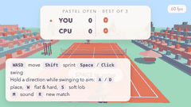 | **机器人网球 · 3D竞技场** | Robo Tennis: 3D Robot Match | 经典街机 | 本地离线 | [sorrycc/fable-arcade](https://github.com/sorrycc/fable-arcade) | 第三人称 3D 机器人网球对决！掌控走位与击球时机，迎战身手敏捷的 CPU 选手！ |
| 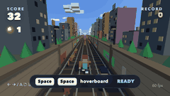 | **铁道跑酷 · 极速冲锋** | Rail Rush: Subway Runner 3D | 经典街机 | 本地离线 | [sorrycc/fable-arcade](https://github.com/sorrycc/fable-arcade) | 致敬《地铁跑酷》的 3D 轨道冲刺！在呼啸疾驰的列车车顶翻滚跳跃，收集无尽金币！ |
| 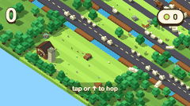 | **疯狂农场斑马线 · 冲出重围** | Crossy Farm: You Are the Car | 休闲治愈 | 本地离线 | [sorrycc/fable-arcade](https://github.com/sorrycc/fable-arcade) | 反转版天天过马路！这次你是一辆小轿车，在遍布牛群与小鸡的田园乡道上疯狂穿行！ |
| 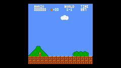 | **超级马里奥 · 经典1-1关卡** | World 1-1: Super Mario Bros Classic | 经典街机 | 本地离线 | [@Claude Fable 5.1+ (sorrycc)](https://github.com/sorrycc/fable-arcade/tree/main/games/mario-1-1) · [体验](games/mario-world.html) | Claude Fable 零素材单文件完美复刻红白机《超级马里奥兄弟》世界 1-1 关卡！ |
| 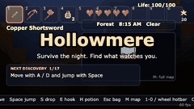 | **空洞之境 · 泰拉瑞亚沙盒生存** | Hollowmere: 2D Sandbox Survival | 3A冒险 | 本地离线 | [@Claude Fable 5.1+ (sorrycc)](https://github.com/sorrycc/fable-arcade/tree/main/games/terraria-sandbox) · [体验](games/hollowmere.html) | 致敬《泰拉瑞亚》的 2D 像素沙盒生存大作！自由挖掘地表地底、砍树筑造家园、召唤并击溃克苏鲁之眼！ |
| 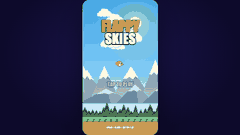 | **像素小鸟 · 晴空翱翔** | Flappy Skies: High-Flying Classic | 休闲治愈 | 本地离线 | [sorrycc/fable-arcade](https://github.com/sorrycc/fable-arcade) | 高品质重制的经典像素小鸟！灵敏的物理气流重力判定，挑战穿梭绿水管的高分巅峰！ |
| 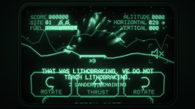 | **矢量月球着陆器 · 1970复古CRT** | Descent: Vector Lunar Lander | 经典街机 | 本地离线 | [@Claude Fable 5.2 (Anthropic)](https://github.com/MiaAI-Lab/Claude-Fable-5.2-HTML-Files) · [体验](games/vector-descent.html) | Claude Fable 5.2 生成的 70 年代 CRT 矢量发光示波管硬核月球着陆器模拟！ |
| 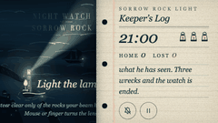 | **悲伤岩灯塔守夜人 · 怒海孤舟** | Night Watch at Sorrow Rock | 3A冒险 | 本地离线 | [MiaAI-Lab](https://github.com/MiaAI-Lab/Claude-Fable-5.2-HTML-Files) | 深具沉浸感的灯塔孤礁生存游戏！在雷暴与狂涛中添柴加油、转动巨大透镜，指引迷航船队归航！ |
| 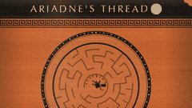 | **阿里阿德涅之线 · 希腊陶画迷宫** | Ariadne's Thread: Ancient Greek Labyrinth | 3A冒险 | 本地离线 | [@Claude Fable 5.2 (Anthropic)](https://github.com/MiaAI-Lab/Claude-Fable-5.2-HTML-Files) · [体验](games/ariadnes-thread.html) | 绝美古希腊黑绘陶器艺术风格！深入克里特同心圆迷宫惊醒米诺陶，沿着红色丝线绝命脱逃！ |
|  | **密室金库破译 · 听声辨位开锁** | The Combination: Vintage Safe Cracker | 休闲治愈 | 本地离线 | [@Claude Fable 5.2 (Anthropic)](https://github.com/MiaAI-Lab/Claude-Fable-5.2-HTML-Files) · [体验](games/the-combination.html) | 1920年代重型铸铁保险箱听音解码！微弱齿轮卡簧声效，精密手感拨盘破译密码！ |
| 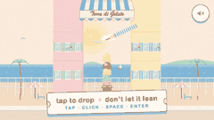 | **意式雪糕叠叠乐 · 一键高塔** | Torre di Gelato: One-Button Scoop Stacker | 休闲治愈 | 本地离线 | [@Claude Fable 5.2 (Anthropic)](https://github.com/MiaAI-Lab/Claude-Fable-5.2-HTML-Files) · [体验](games/gelato-tower.html) | 高弹性物理碰撞的单键冰淇淋堆叠游戏！开心果、覆盆子、海盐焦糖，打造耸入云霄的雪糕塔！ |
| 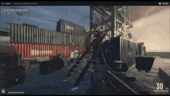 | **Three Games · 三合一神作合集 (Saltline / 钟表匠 / Tidewright)** | Three Games: Fable 5.2 Trio | 经典街机 | 云端嵌入 | [@felixrieseberg](https://x.com/felixrieseberg) · [体验](https://claude.ai/artifact/MXxb36zKgN261ckbGhmNin) | Felix Rieseberg 发布的传奇合集：包含 Saltline、钟表匠之心与 Tidewright 三款零人工反馈初稿作品。 |
|  | **Mirror Earth · 镜像地球 (实时天气全境破坏模拟)** | Mirror Earth: Destructible Planet | 3A冒险 | 云端嵌入 | [@mattshumer_](https://x.com/mattshumer_) · [体验](https://www.spawn.co/@mattshumer/earth?room=local) | 以整个真实地球为沙盒：全境地表可自由穿梭与摧毁，天气数据与现实世界全球实时同步。 |
|  | **Voxel Engine · 纯原生 3D 体素方块沙盒** | Voxel Engine 3D Sandbox | 3A冒险 | 云端嵌入 | [@mattshumer_](https://x.com/mattshumer_) · [体验](https://www.spawn.co/@mattshumer/voxel-engine) | 由 Fable 5.2 生成的纯网页体素渲染引擎，支持程序化地形生成、动态光照与实时方块搭建拆除。 |
| 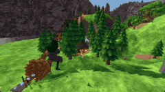 | **Hogwarts Royale · 霍格沃茨魔法吃鸡大逃杀** | Hogwarts Royale: Magic Battle Royale | 动作射击 | 云端嵌入 | [@mattshumer_](https://x.com/mattshumer_) · [体验](https://www.spawn.co/@mattshumer/hogwarts-royale) | 手持魔杖的 3D 大逃杀竞技场：毒圈不断收缩，收集全图上古魔咒与飞天扫帚，决战至最后一巫师！ |
| 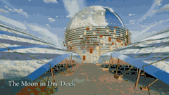 | **Portals: Endless Worlds · 传送门无尽异界穿梭** | Portals: Endless Worlds | 3A冒险 | 云端嵌入 | [@emollick](https://x.com/emollick) · [体验](https://portals-endless-worlds.netlify.app/) | 由沃顿商学院教授 Ethan Mollick 提示词促成：步入一道道传送门，无缝跨越数十个奇幻的程序化生成异维度。 |
| 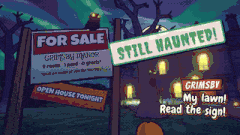 | **I Would Have Gotten Away · 逆向解谜捉迷藏侦探** | I Would Have Gotten Away With It | 休闲治愈 | 云端嵌入 | [@emollick](https://x.com/emollick) · [体验](https://i-would-have-gotten-away-with-it.netlify.app/) | 经典史酷比侦探剧的反转：这次你扮演幽灵反派，必须在爱管闲事的小分队揭露真相前精心布置机关！ |
|  | **What the Water Keeps · 水之秘境深渊叙事冒险** | What the Water Keeps: Deep Narrative | 3A冒险 | 云端嵌入 | [@kevin_t_ngo](https://x.com/kevin_t_ngo) · [体验](https://what-the-water-keeps.vercel.app/) | Kevin Ngo 潜心打造的深水互动艺术之作：在幽暗水域潜行，打捞沉睡在深渊之底的记忆回响。 |
| 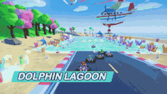 | **Turbo Tails · 涡轮尾迹狂飙竞速** | Turbo Tails Arcade Racer | 竞速漂移 | 云端嵌入 | [@petergyang](https://x.com/petergyang) · [体验](https://turbo-tails.vercel.app) | 由 Peter Yang 制作的超爽快 3D 街机竞速：喷射彩色粒子尾迹，在弯道连续极限漂移蓄满氮气！ |
| 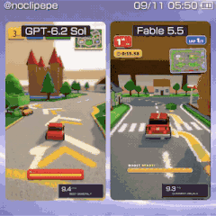 | **Childhood Rug Racer · 地毯童年小汽车怀旧竞速** | Childhood Rug Racer | 竞速漂移 | 云端嵌入 | [@noclipepe](https://x.com/noclipepe) · [体验](https://noclipepe.pages.dev/rug/) | 让全世界网友瞬间泪目的创意之作：在小时候房间里印着道路和房屋的经典交通游戏地毯上开车！ |
| 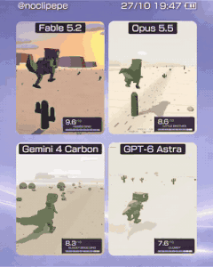 | **Rambo Dino · 兰博恐龙热血横版街机扫射** | Rambo Dino 2D Action | 经典街机 | 云端嵌入 | [@noclipepe](https://x.com/noclipepe) · [体验](https://noclipepe.pages.dev/dino) | 一只身绑红色头巾、手提重型加特林机枪的霸王龙横扫战场，重温合金弹头般的爽快突突突！ |
| 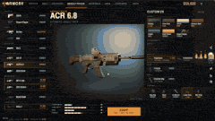 | **Frontline Warfare · 前线战争殊死对决** | Frontline Warfare Deathmatch | 动作射击 | 云端嵌入 | [@alightinastorm](https://x.com/alightinastorm) · [体验](https://spawn.co/@robot/frontline-warfare-deathmatch) | 沉浸式 3D 团队死斗对抗：在饱受炮火洗礼的工业阵地穿梭，依靠战术掩体与精准点射击退敌军。 |
| 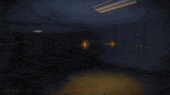 | **Feed the Backrooms · 喂养后室恐怖逃脱** | Feed the Backrooms | 动作射击 | 云端嵌入 | [@LexnLin](https://x.com/LexnLin) · [体验](https://feed-backrooms.vercel.app) | 迷失在无限泛黄墙纸与日光灯蜂鸣声的'后室'中，收集祭品喂养游荡的潜伏实体，寻找逃出生天的出口！ |
|  | **Cloud Stunt 3D · 云端特技飞行竞速** | Cloud Stunt 3D | 竞速漂移 | 云端嵌入 | [@jev_chat](https://x.com/jev_chat) · [体验](https://finderchangchang.github.io/cloud-stunt-3d/) | 驾驶高机动特技单翼机在壮阔云海穿行：穿越浮空光环，完成桶滚与失速俯冲挑战极速纪录！ |
| 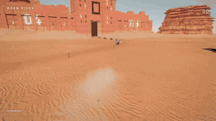 | **Worm Rider · 沙虫骑手沙漠冒险** | Worm Rider: Dune Odyssey | 3A冒险 | 云端嵌入 | [@AmirMushich](https://x.com/AmirMushich) · [体验](https://github.com/amirmushichge/worm-rider) | 致敬《沙丘》的史诗级沙漠狂飙：召唤并驾驭百米长的远古巨型沙虫，在漫天黄沙中穿梭征服荒原！ |
| 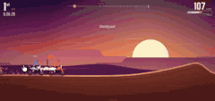 | **Roost · 泥地越野摩托冲刺** | Roost Dirt Bike Stunt | 竞速漂移 | 云端嵌入 | [@tejas3732](https://x.com/tejas3732) · [体验](https://claude.ai/artifact/DLnFodkTwvawCNwurDmSZK?sk=5N6PtC07f1niB7h3I6clZQ) | 轰鸣的二冲程引擎与泥浆四溅的越野赛道：驾驭轻量级越野摩托，在起伏土坡完成超高难度的腾空翻转！ |
| 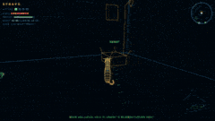 | **Stray Cat · 流浪猫城市模拟** | Stray Cat City Simulator | 休闲治愈 | 云端嵌入 | [@aimikoda](https://x.com/aimikoda) · [体验](https://claude.ai/artifact/4nPXUKJjQWNsZEHVNmXXCt) | 化身一只敏捷小猫穿梭在现代都市的屋顶与小巷：跳上空调外机、打翻桌上水杯，享受悠闲猫生！ |
|  | **Tilt Labyrinth · 重力倾斜迷宫** | Tilt Labyrinth | 休闲治愈 | 云端嵌入 | [@mylifcc](https://x.com/mylifcc) · [体验](https://blog.silencestar.com/posts/tilt-labyrinth/play/) | 经典物理木盘滚珠桌游重现：倾斜盘面控制钢珠精准避开密密麻麻的深坑陷阱，平稳滚入终点星标！ |
| 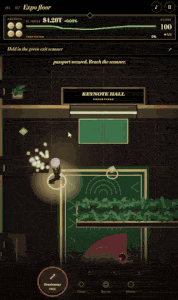 | **Silicon Seduction · 硅基诱惑黑客RPG** | Silicon Seduction Cyber RPG | 角色扮演 | 云端嵌入 | [@ZryMiller](https://x.com/ZryMiller) · [体验](https://silicon-seduction.vercel.app/) | 霓虹雨夜下的赛博朋克黑客角色扮演：潜入巨型财阀核心数据库，在道德边缘抉择人类与 AI 的未来！ |
|  | **Vippi · 极简霓虹快节奏射击** | Vippi Neon Arena Shooter | 动作射击 | 云端嵌入 | [@Shrit1401](https://x.com/Shrit1401) · [体验](https://vippi.vercel.app/) | 灵感源自经典几何战争的快节奏竞技场射击：纯黑背景与璀璨发光霓虹线框，在密集弹幕中瞬间闪避消灭敌人！ |
| 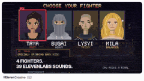 | **Four-character Fight · 声控格斗四字乱斗** | Four-Character Fighting Game | 经典街机 | 云端嵌入 | [@promodenstudio](https://x.com/promodenstudio) · [体验](https://claude.ai/artifact/1QGGhB68jMCjjjeeKtKNUo) | 由 Promoden Studio 打造的硬派 2D 街机格斗：四位身怀绝技的武术宗师，支持经典按键搓招与连击必杀！ |
| 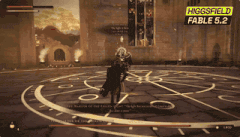 | **VOWLORN · 破誓者全代码奇幻RPG** | VOWLORN Fantasy Code RPG | 角色扮演 | 云端嵌入 | [@higgsfield_ai](https://x.com/higgsfield_ai) · [体验](https://higgsfield.ai/@higgsfield.studio/blogs/fable-5-2-built-this-rpg-from-pure-code-here-s-every-step) | Higgsfield 团队全网刷屏的里程碑之作：100% 纯代码由 Fable 5.2 生成，深度暗黑奇幻地下城冒险与装备构筑！ |
|  | **Oil Paint · 油画质感沉浸探索** | Oil Paint: Hand-Painted World | 3A冒险 | 云端嵌入 | [@BlendiByl](https://x.com/BlendiByl) · [体验](https://patch.gg/blendi/oil-paint) | 宛如漫步在印象派大师画布之中的艺术游戏：厚涂油彩笔触随微风起伏，探寻画布背后的生命诗篇！ |
|  | **CROSSTOWN · 纽约开放世界极速穿行** | CROSSTOWN: Open-World NYC | 动作射击 | 云端嵌入 | [@mattshumer_](https://x.com/mattshumer_) · [体验](https://nyc.somethingbig.ai/) | Matt Shumer 轰动推特的'7天挑战'巨制：程序化纽约曼哈顿高楼林立，在车流穿梭中体验次世代开放都市！ |
| 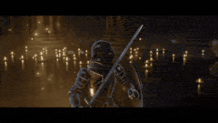 | **Evensong · 暮歌暗黑魂系地牢** | Evensong: Souls-like Odyssey | 动作射击 | 云端嵌入 | [@kevin_t_ngo](https://x.com/kevin_t_ngo) · [体验](https://evensong-phi.vercel.app/) | Kevin Ngo 倾力打磨的硬核魂系动作神作：点燃幽暗营火，精准弹反首领重击，在绝望中寻找破晓微光！ |
| 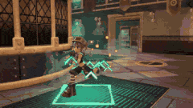 | **Gilt & Gutter · 镀金与阴沟黑帮巷战** | Gilt & Gutter Noir Action | 动作射击 | 云端嵌入 | [@kevin_t_ngo](https://x.com/kevin_t_ngo) · [体验](https://gilt-and-gutter.vercel.app/) | 1940 年代黑白诺瓦尔黑色电影风格：在雨夜迷离的罪恶小巷中，手持汤姆逊冲锋枪展开殊死对决！ |
| 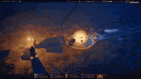 | **LANTERNFALL · 提灯骤降暗影生存** | LANTERNFALL: Shadow Descent | 3A冒险 | 云端嵌入 | [@loktar00](https://x.com/loktar00) · [体验](https://loktar00.github.io/lanternfall/) | Loktar00 呈现的幽闭暗影生存神作：提灯是你唯一的生命依托，在无尽黑夜中添油续命，躲避阴影生物！ |
| 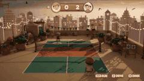 | **Rooftop Rally · 屋顶匹克球竞技** | Rooftop Rally: Skyline Pickleball | 经典街机 | 云端嵌入 | [@chongdashu](https://x.com/chongdashu) · [体验](https://wavedash.com/games/rooftop-rally) | 在摩天大楼天台打当下最火爆的匹克球！精准切球、强力扣杀，在开阔云海全景下与强劲 AI 争夺天台球王！ |
| 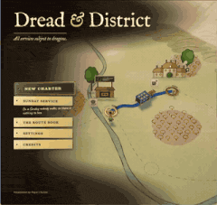 | **Dread & District · 恐惧街区悬疑解谜** | Dread & District Mystery | 休闲治愈 | 云端嵌入 | [@emollick](https://x.com/emollick) · [体验](https://dread-and-district.netlify.app) | 穿行在雾气弥漫的维多利亚式老街区：搜集散落物证、破解机关锁扣，拼凑出隐藏在黑夜背后的惊人谜案！ |
| 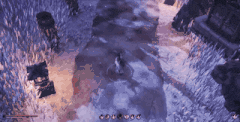 | **Mist-Locked Mountain · 雾锁山门国风硬核3D动作** | Mist-Locked Mountain Gate 3D | 动作射击 | 云端嵌入 | [@op7418](https://x.com/op7418) · [体验](https://op7418.github.io/guizang-game-skill/) | 国内顶尖技术博主 op7418 耗费 45 亿 Token 打造：单 HTML 文件打包 30MB 完整国风硬核动作游戏，模型动作光影惊艳！ |
| 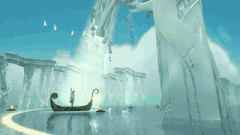 | **The Waking River · 苏醒之河唯美漂流之旅** | The Waking River | 3A冒险 | 云端嵌入 | [@flxrnc](https://x.com/flxrnc) · [体验](https://rivergame-kappa.vercel.app) | 乘一叶扁舟顺流而下：倾听两岸潺潺流水与鸟鸣，在晨曦与星光交替间体验一场洗涤心灵的唯美漂流。 |
| 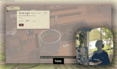 | **First Crush · 初见心动青春互动模拟** | First Crush Romance Sim | 休闲治愈 | 云端嵌入 | [@kieranklaassen](https://x.com/kieranklaassen) · [体验](https://frontier.every.to/experiments/first-crush) | 重温校园时代的青涩与悸动：细腻的心情互动分支，每一个微小眼神与话语选择都将决定好感度的走向！ |
| 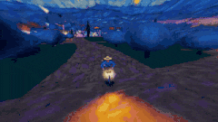 | **Starry Nightrider · 星夜骑士赛博巡航** | Starry Nightrider Cyber Cruise | 3A冒险 | 云端嵌入 | [@ebbyamir](https://x.com/ebbyamir) · [体验](https://starrynightrider.com) | Ebbyamir 打造的 Synthwave 赛博巡航：驾驶改装跑车穿行在紫金色调的星空高速，沉醉于合成器电音！ |
| 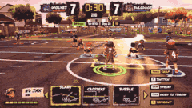 | **YARDCLASH · 庭院冲突多人对撞** | YARDCLASH Arena Brawler | 经典街机 | 云端嵌入 | [@AugustCastilIo](https://x.com/AugustCastilIo) · [体验](https://yardclash.vercel.app/) | 后院派对大乱斗：操纵软趴趴的布娃娃角色，捡起割草机、烧烤架和充气泳池玩具将对手撞飞出场地！ |
| 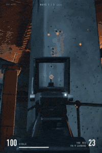 | **Fable 5.2 FPS Repro · 工业射击纯净复现** | Fable 5.2 FPS Repro | 动作射击 | 云端嵌入 | [@wquguru](https://x.com/wquguru) · [体验](https://wquguru.github.io/fable52-fps-repro/) | 开发者 wquguru 对官方发布会经典 FPS 演示的纯净完整复现：独立还原光影集装箱码头与完整射击管线！ |
| 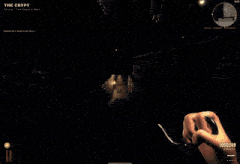 | **Lumina Zombies · 卢米娜丧尸无尽狂潮** | Lumina Zombies Survival | 动作射击 | 云端嵌入 | [@LuminaBench](https://x.com/LuminaBench) · [体验](https://luminazombies.com/) | 由 LuminaBench 呈现的黑夜丧尸生存大潮：在四面涌来的无尽丧尸尸潮中杀出血路，升级军火库坚守黎明！ |
| 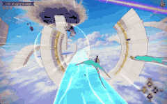 | **SKYWAKE · 天际尾流战斗飞行** | SKYWAKE Aerial Combat | 动作射击 | 云端嵌入 | [@aniketjart](https://x.com/aniketjart) · [体验](https://app.usecrayon.ai/play/992c2130-43da-416b-a577-aed9514d3057) | 由 Aniket 打造的现代空战狗斗传奇：驾驭第五代隐形战机冲破音障，在万米高空锁定敌机发射响尾蛇导弹！ |
| 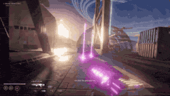 | **Ringfall · 环形陨落太空射击** | Ringfall Orbital Strike | 动作射击 | 云端嵌入 | [@rehan_shei](https://x.com/rehan_shei) · [体验](https://patch.gg/games/rehan/ringfall) | Rehan Shei 构筑的巨型太空环世界枪战：在失重的轨道环形甲板跳跃穿梭，用光子等离子枪击碎机械叛军！ |
| 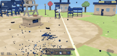 | **Chairmageddon · 椅子大狂欢物理浩劫** | Chairmageddon Physics Havoc | 休闲治愈 | 云端嵌入 | [@argofowl](https://x.com/argofowl) · [体验](https://fowllabs.com/fable-5-2/chairmageddon/) | Fowl Labs 出品的终极办公室解压神器：成百上千把旋转办公椅如同海啸般多米诺连锁撞击，彻底摧毁无聊！ |

---

## ✨ 核心功能与亮点

- 🎨 **CrazyGames 沉浸式暗黑霓虹风格**：深邃蓝黑底色、霓虹紫/青光效、卡片流光边框、水波纹与 3D 微动效。
- 🔍 **全局实时搜索与过滤**：支持中英文标题、拼音、标签检索，支持 `/` 或 `Ctrl+K` 快速呼出。
- 🌐 **双语多语言系统**：顶栏一键切换中/英文，游戏元数据、操作指南与全站 UI 丝滑本地化。
- 🏟️ **独立竞技场播放器 (Game Arena)**：
  - 剧场模式 (Theater Mode)、原生全屏 (Fullscreen API)、重置刷新。
  - **独立新窗口打开 (`↗️ 独立窗口`)**：支持跳脱 iframe 并在全屏独立标签页中运行。
  - **一键直达 GitHub 源码 (`💻 源码`)**：每个游戏均可直接访问对应的开源仓库。
  - **清晰按键指南**：WASD、方向键、鼠标技能一目了然。
  - **无残留路由**：采用 `location.replace` 优化，点击浏览器“后退”平滑返回大厅，不污染浏览历史。
- 💾 **本地持久化存储 (LocalStorage)**：自动同步我的收藏、游玩记录与游戏点赞数。
- 🚀 **Vercel / GitHub Pages 一键部署**：预置 `vercel.json` 规则，无需后端或构建脚本，开箱即用。

---

## ➕ 如何在 1 分钟内添加新游戏？

详细步骤请参考 [`HOW_TO_ADD_GAMES.md`](file:///Users/wangwei/workspace/project/fablegames/HOW_TO_ADD_GAMES.md)：
1. 将单文件 `.html` 游戏放入 `games/` 目录（或使用外部 HTTPS 游戏链接）。
2. 在 `js/games-data.js` 中追加一段游戏配置即可！

---

## 📄 开源许可

[MIT License](LICENSE)
